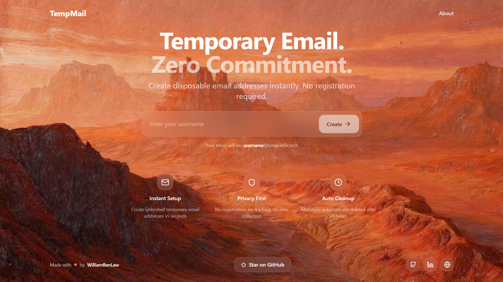

# Temp Mail

A self-hosted disposable email service. Pick a name (or get a random one), share the address, and read incoming mail in the browser. Mailboxes and messages delete themselves after 24 hours.



- **Receive-only SMTP server**: accepts mail for your domain and refuses to relay anything else.
- **Live inbox**: polls for new mail automatically, with unread markers and new-mail notifications.
- **Safe email rendering**: HTML is sanitized and shown in a sandboxed iframe with no scripts. Remote images are blocked until you allow them.
- **Attachments and inline images**, plus `.eml` download.
- **Automatic cleanup** of expired mailboxes and messages.
- **No accounts and no tracking.** Analytics (PostHog) are optional and never receive addresses or message content.

## Architecture

```
                    ┌────────────────────────── docker compose ──────────────────────────┐
 Browser ──HTTPS──► │ Caddy ──/api/*──► backend (Express API :3001) ──► PostgreSQL       │
                    │   │                   ▲                                            │
                    │   └──────other──► frontend (Next.js :3000)                         │
 Mail servers ─25──►│               backend (SMTP :2525) ──────────────► PostgreSQL       │
                    └────────────────────────────────────────────────────────────────────┘
```

| Part | Stack |
| --- | --- |
| `frontend/` | Next.js 16 (App Router), React 19, Tailwind CSS 4, DOMPurify, GSAP, Lenis |
| `backend/` | Node 24, Express 5, `smtp-server` + `mailparser`, Prisma 7 (PostgreSQL), Zod, Pino |
| `deploy/` | Caddyfile (automatic HTTPS) |

The frontend always calls the API on its own origin at `/api`. In the Docker stack, Caddy sends `/api/*` straight to the backend. Elsewhere (local dev, Vercel), the Next.js route handler in `frontend/app/api/[...path]` proxies to `API_URL`. Either way the browser never needs CORS.

## Quick start (local development)

Requirements: Node.js 22.12+ (24 recommended) and PostgreSQL. Docker is the easiest way to get Postgres.

```bash
docker compose -f docker-compose.dev.yml up -d
```

```bash
cd backend
cp .env.example .env
npm install
npx prisma migrate deploy
npm run dev
```

```bash
cd frontend
cp .env.example .env.local
npm install
npm run dev
```

Open http://localhost:3000. To deliver a test message (HTML, inline image and attachment) to the local SMTP server on port 2525:

```bash
cd backend && npm run send-test-email -- yourname
```

### Useful scripts

| Where | Command | What it does |
| --- | --- | --- |
| backend | `npm run dev` | API + SMTP with reload |
| backend | `npm test` | Unit and API tests (Vitest) |
| backend | `npm run typecheck` / `npm run build` | Type-check / compile to `dist/` |
| backend | `npm run prisma:migrate` | Create a new migration after editing `prisma/schema.prisma` |
| frontend | `npm run lint` / `npm run typecheck` / `npm run build` | ESLint / tsc / production build |

## Deploying

### Option A: one server with Docker Compose (recommended)

Everything runs on one VPS: Postgres, backend, frontend, and Caddy, which gets TLS certificates automatically.

1. **Server**: any Linux VPS with a public IPv4 address and **inbound port 25 open**. Some providers block port 25 by default, so check before you choose one.
2. **DNS** (here `SITE_DOMAIN` and `MAIL_DOMAIN` are both `tempmail.example.com`):
   ```
   tempmail.example.com.   A     <server-ip>
   tempmail.example.com.   MX 10 tempmail.example.com.
   ```
   Set the server's reverse DNS (PTR) to the same hostname if your provider supports it.
3. **Configure and start**:
   ```bash
   git clone <your-repo-url> temp-mail && cd temp-mail
   cp .env.example .env        # set SITE_DOMAIN, MAIL_DOMAIN, POSTGRES_PASSWORD
   docker compose up -d --build
   ```
   The backend applies database migrations on every start.
4. **Firewall**: allow 22, 25, 80 and 443.
5. **Check it**:
   ```bash
   curl https://tempmail.example.com/api/health      # {"ok":true,"database":"up",...}
   docker compose logs -f backend
   ```
   Then send an email from Gmail or similar to `anything@tempmail.example.com`.

To update, run `git pull && docker compose up -d --build`.

### Option B: frontend on Vercel, backend on a VPS

- **Backend**: run `backend/Dockerfile` (or `npm ci && npm run build && npm run start:prod`) on a host with port 25 open. Put it behind a TLS reverse proxy such as `api.example.com`, and set `TRUST_PROXY=1`.
- **Frontend**: import the repository into Vercel with **Root Directory = `frontend`**. Set `API_URL=https://api.example.com` and `NEXT_PUBLIC_SITE_URL=https://example.com`.

## Configuration

### Backend (`backend/.env`)

| Variable | Default | Description |
| --- | --- | --- |
| `DATABASE_URL` | **required** | PostgreSQL connection string |
| `MAIL_DOMAIN` | **required** | Domain that receives mail (`SMTP_DOMAIN` also accepted) |
| `API_PORT` / `API_HOST` | `3001` / `0.0.0.0` | HTTP API listener |
| `SMTP_PORT` / `SMTP_HOST` | `2525` / `0.0.0.0` | SMTP listener (map public port 25 to it) |
| `SMTP_HOSTNAME` | `MAIL_DOMAIN` | Name in the SMTP greeting |
| `SMTP_MAX_MESSAGE_BYTES` | `10485760` | Larger messages are rejected with 552 |
| `SMTP_MAX_RECIPIENTS` | `50` | Recipients per message |
| `SMTP_TLS_KEY_PATH` / `SMTP_TLS_CERT_PATH` | – | Enable STARTTLS with these PEM files |
| `MAILBOX_TTL_HOURS` | `24` | Lifetime of mailboxes and messages. New mail extends the mailbox. |
| `TRUST_PROXY` | `loopback` | Express `trust proxy` (hop count, `true`, or subnets). Needed for per-IP rate limits behind a proxy. |
| `CORS_ORIGINS` | – | Only needed if browsers call the API from another origin |
| `MAILBOX_CREATE_LIMIT_PER_HOUR` | `20` | New mailboxes per IP per hour (re-opening an existing one is free) |
| `API_RATE_LIMIT_PER_MINUTE` | `120` | Requests per IP per minute |
| `CLEANUP_ENABLED` / `CLEANUP_INTERVAL_MINUTES` | `true` / `15` | Expired-data cleanup |
| `LOG_LEVEL` | `info` | Pino log level (JSON logs in production) |
| `POSTHOG_KEY` / `POSTHOG_HOST` | – | Optional server analytics |

Invalid or missing configuration stops the server at startup with a clear message.

### Frontend (`frontend/.env.local`)

| Variable | Description |
| --- | --- |
| `API_URL` | Backend URL used by the `/api` proxy (runtime, server-side). Default `http://localhost:3001`. |
| `NEXT_PUBLIC_SITE_URL` | Public site URL for metadata, robots.txt and the sitemap (build time) |
| `NEXT_PUBLIC_MAIL_DOMAIN` | Optional placeholder shown until `/api/config` loads |
| `NEXT_PUBLIC_API_URL` | Optional: have browsers call the API directly (needs backend `CORS_ORIGINS`) |
| `NEXT_PUBLIC_SOURCE_URL` | Source-code link in the footer (build time). Point it at your fork if you modify the app (AGPL). `SOURCE_URL` in the root `.env` for Docker. |
| `NEXT_PUBLIC_POSTHOG_KEY` / `NEXT_PUBLIC_POSTHOG_HOST` | Optional analytics |

## API

All routes are under `/api`. `:name` is the part of the address before the `@`.

| Method | Route | Description |
| --- | --- | --- |
| `GET` | `/health` | Liveness and database check (`503` if the database is down) |
| `GET` | `/config` | `{ domain, ttlHours, maxMessageBytes }` |
| `POST` | `/mailboxes` | Body `{ "username"?: string }`. Returns `201` when created, `200` if it already existed. Omit the username for a random one. |
| `GET` | `/mailboxes/:name` | Mailbox info and message summaries (newest first) |
| `DELETE` | `/mailboxes/:name` | Delete the mailbox and all of its messages |
| `GET` | `/mailboxes/:name/messages/:id` | Full message: `html`, `text`, `attachments`. Marks it read. |
| `DELETE` | `/mailboxes/:name/messages/:id` | Delete one message |
| `GET` | `/mailboxes/:name/messages/:id/raw` | Original message as `.eml` |
| `GET` | `/mailboxes/:name/messages/:id/attachments/:index` | Attachment download. Only safe raster images are shown inline. Add `?download` to force a download. |

Errors are JSON: `{ "error": "message" }`.

## Security notes

- **Anyone who knows an address can read its inbox.** That is how temporary mail works, so never use it for anything sensitive. Random names (`swift-otter-4821`) are harder to guess than custom ones.
- Email HTML goes through DOMPurify and is rendered in an `<iframe sandbox>` without `allow-scripts`, under its own Content Security Policy. Remote content is blocked by default.
- Attachments are served with `Content-Security-Policy: sandbox` and `nosniff`. Anything other than PNG, JPEG, GIF, WebP, AVIF or BMP images is forced to download.
- The site sends `Referrer-Policy: no-referrer`, so links clicked inside emails don't reveal the mailbox URL. `robots.txt` keeps mailboxes out of search engines.
- The SMTP server only accepts recipients on `MAIL_DOMAIN`, so it is not an open relay. It has message-size and recipient limits.

## License

[GNU Affero General Public License v3.0](./LICENSE) (AGPL-3.0). Originally created by [WilliamBenLaw](https://github.com/SheerWill007/TemptingMail).

The AGPL applies to network use. If you run a modified version of this service for other people, you must offer those users the source code of your version. The footer links to it: set `NEXT_PUBLIC_SOURCE_URL` to your repository.
