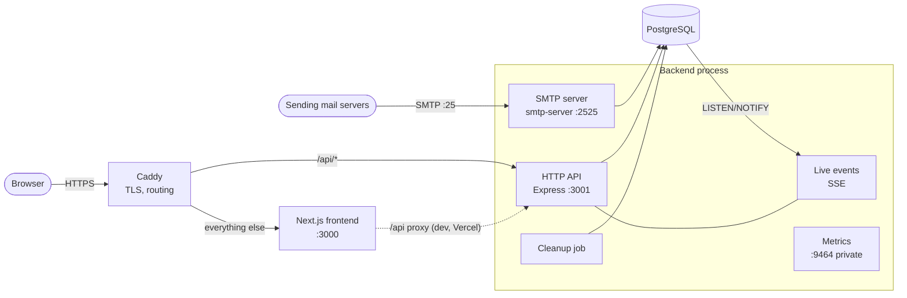

# Architecture

## Components



| Component                                            | Responsibility                                                                                                                                                                                                           |
| ---------------------------------------------------- | ------------------------------------------------------------------------------------------------------------------------------------------------------------------------------------------------------------------------ |
| **SMTP server** (`backend/src/smtp`)                 | Receive-only MX for `MAIL_DOMAIN`. Rejects relaying, reserved names, oversized messages, too many recipients, and over-limit connections. Parses each message once, stores it per recipient, and publishes a live event. |
| **HTTP API** (`backend/src/api`)                     | Mailbox lifecycle, message retrieval, attachments, raw source, live event stream, health probes, OpenAPI spec.                                                                                                           |
| **Mail store** (`backend/src/services/mailStore.ts`) | All database access for mailboxes and messages.                                                                                                                                                                          |
| **Event bridge** (`backend/src/services/events.ts`)  | Delivers new-mail events in-process and across instances (Postgres `NOTIFY` on `tempmail_mail_received`).                                                                                                                |
| **Cleanup** (`backend/src/services/cleanup.ts`)      | Deletes expired messages and mailboxes on an interval. It is idempotent, so it is safe on several instances.                                                                                                             |
| **Frontend** (`frontend/`)                           | Next.js App Router UI. Calls the API on its own origin (`/api`).                                                                                                                                                         |

## Request flows

### Receiving mail

1. A sending server connects. `onConnect` applies the per-IP connection limit.
2. For each `RCPT TO`, the recipient domain must equal `MAIL_DOMAIN`, the local part must be valid and not reserved, and the recipient count must be under the limit.
3. `DATA` is buffered up to `SMTP_MAX_MESSAGE_BYTES` (552 if larger), then parsed once with `mailparser`.
4. In one transaction, each recipient mailbox is upserted (its expiry is extended) and a `Message` row is created with a precomputed preview.
5. After commit, an event is published locally and via `pg_notify`, so open inboxes refresh immediately.

### Reading mail

1. `POST /api/mailboxes` creates or re-opens the mailbox. Only real creations (HTTP 201) count against the per-IP creation limit.
2. The inbox page subscribes to `GET /api/mailboxes/:name/events` (Server-Sent Events) and refetches `GET /api/mailboxes/:name` on each event. If the stream is unavailable, it polls every 10 seconds; while live, it still re-checks every 60 seconds as a safety net.
3. `GET /api/mailboxes/:name/messages/:id` parses the stored raw message and rewrites `cid:` image references to attachment URLs. The client sanitizes the HTML with DOMPurify and renders it in a sandboxed iframe.

## Data model

```
Mailbox (address UNIQUE, createdAt, expiresAt)
   1 ── * Message (from, subject, preview, size, hasAttachments, isRead, raw BYTEA, createdAt, expiresAt)
```

- `raw` stores the original RFC 5322 message. Attachments and HTML are derived from it on demand.
- The indexes on `expiresAt` serve cleanup; `(mailboxId, createdAt)` serves inbox listing.
- Deleting a mailbox cascades to its messages.

## Key design decisions

| Decision                                      | Rationale                                                                                                                                       |
| --------------------------------------------- | ----------------------------------------------------------------------------------------------------------------------------------------------- |
| Same-origin `/api`                            | No CORS in the browser. Inline images resolve naturally. `API_URL` is a runtime setting rather than baked into the build.                       |
| Store the raw message, derive everything else | Keeps the original source available for `.eml` download and future features. The preview is precomputed so listing the inbox never parses MIME. |
| Server-Sent Events, not WebSockets            | One-way notifications only. Works through HTTP proxies and CDNs, and the browser reconnects automatically.                                      |
| Postgres LISTEN/NOTIFY for fan-out            | Multiple backend instances need no extra infrastructure such as Redis.                                                                          |
| Sanitize and sandbox                          | DOMPurify removes active content; the sandboxed iframe (no `allow-scripts`) and per-frame CSP contain anything that slips through.              |
| Reserved role names                           | Prevents hijacking domain-validation mail such as certificate approvals.                                                                        |
| Metrics on a separate port                    | Prometheus data is never reachable through the public proxy.                                                                                    |

## Scaling notes

- **Stateless HTTP/SMTP**: run several backend replicas behind a TCP load balancer for port 25 and an HTTP load balancer for the API.
- **Live events** work across replicas through Postgres NOTIFY.
- **Rate limits** are kept in memory per instance. With N replicas, the effective limit is up to N times the configured value. Use sticky sessions, or move limits to a shared store, if that matters.
- **Database**: messages are small, and `raw` is TOAST-compressed. Size the database for roughly peak mail volume × TTL.
